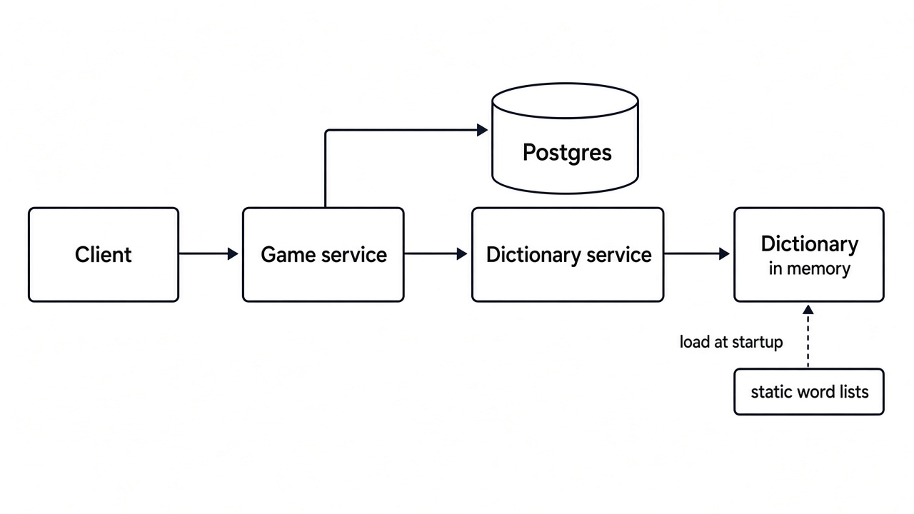

# Custom Wordle

A full-stack Wordle you can play in the browser. You can play as many games as you want. Each game uses a word of 5 to 8 letters, and you get one more guess than the word length (six guesses for five letters, nine for eight).

Rules for scoring a guess are the usual Wordle rules. The original prompt is in [ASSESSMENT.md](ASSESSMENT.md).

## Quick start

```bash
# Terminal 1: API + Postgres (wait for "Application startup complete")
docker compose up --build

# Terminal 2: UI
cd frontend && npm install && npm run dev
```

Then open http://localhost:5173.

## Prerequisites

- Docker with Compose, for the API and Postgres. The backend runs on Python 3.12 inside the image.
- Node.js 20.19 or newer, for the frontend (Vite 7).
- Ports 8000 (API), 5173 (UI) and 5432 (Postgres) free on your machine.

## Run locally

From the repo root, start the API and the database:

```bash
docker compose up --build
```

- API: http://localhost:8000
- Interactive API docs: http://localhost:8000/docs

The first build takes a minute. The API container mounts `./backend` and runs with `--reload`, so backend edits apply without a rebuild.

In a second terminal, start the UI:

```bash
cd frontend
npm install
npm run dev
```

Open http://localhost:5173. The app lands on `/play`. `/new` starts a game at a length you choose.

The UI talks to `http://localhost:8000/api/v1` by default, so no configuration is needed for a local demo.

Stop the UI with Ctrl+C, and stop the API and database with:

```bash
docker compose down
```

Postgres data stays in the `postgres_data` volume. `docker compose down -v` deletes that volume and the games in it.

The database user, password, and database name in [docker-compose.yml](docker-compose.yml) are for this local setup only.

## How to play

- Pick a word length from 5 to 8 and start a game. You get one more guess than the word has letters.
- Type with your keyboard or the on-screen keys, then press Enter.
- Green means the letter is correct and in the right place. Yellow means it is in the word but in another place. Grey means it is not in the word (repeated letters follow the usual Wordle rules).
- Refreshing the page resumes your game. "New game" asks before abandoning one in progress.
- When a game ends you can view the board or play again.

## API

Base path `/api/v1`. Try it in the interactive docs at http://localhost:8000/docs, or with curl:

| Method and path | Purpose |
|---|---|
| `POST /games` | Start a game. Body `{"word_length": 5}` |
| `GET /games/{game_id}` | Load a game |
| `POST /games/{game_id}/guess` | Submit a guess. Body `{"guess": "crane"}` |

```bash
curl -s -X POST localhost:8000/api/v1/games -H 'Content-Type: application/json' -d '{"word_length": 5}'
curl -s -X POST localhost:8000/api/v1/games/<game_id>/guess -H 'Content-Type: application/json' -d '{"guess": "crane"}'
```

Errors share one shape, `{"detail", "error_code", "status_code"}`:

| Status | `error_code` | Meaning |
|---|---|---|
| 400 | `invalid_guess`, `word_not_in_dictionary`, `invalid_word_length` | The guess or length is not valid |
| 404 | `game_not_found` | Unknown game id |
| 409 | `game_already_finished` | The game was already won or lost |
| 409 | `game_busy` | Another request is using the game. Retry |
| 422 | `request_validation_error` | Malformed request body |
| 503 | `storage_unavailable` | The database is unavailable |

## Project layout

```
backend/app/
  api/            routes and dependencies
  services/       GameService (rules flow) and DictionaryService
  domain/         GameState and pure scoring rules
  repositories/   GameStore interface and the Postgres implementation
  models/ schemas/  SQLAlchemy model and API schemas
backend/alembic/  migrations
frontend/src/
  api/            fetch client with timeout and typed errors
  hooks/          useGame, useGuessInput, useKeyboardInput
  components/     Board, Keyboard, LengthPicker, Modal (each with its own CSS)
  pages/          PlayPage, NewGamePage
```

## Tests

Frontend tests do not need the API:

```bash
cd frontend
npm test
```

Backend tests use Python 3.12 (use `python3.12` if your default `python3` is newer or older). Install the dev dependencies, then run pytest from `backend/`:

```bash
cd backend
python3.12 -m venv .venv
source .venv/bin/activate
pip install -r requirements-dev.txt
pytest
```

`pytest` includes the store tests in `backend/tests/integration/`. Those tests expect Postgres from Compose on `localhost:5432` and create a separate `wordle_test` database so they do not write to the app database. Start Compose before running the full suite.

The game-rule tests use an in-memory stand-in for the store, so this subset does not need Postgres:

```bash
pytest tests/test_game_service.py tests/test_dictionary_service.py tests/test_exception_handlers.py
```

## Troubleshooting

- **Port already in use:** stop whatever is on 8000, 5173 or 5432, or change the host port in [docker-compose.yml](docker-compose.yml).
- **Container name conflict (`wordle_postgres`):** another Compose project is using that name. Run `docker rm -f wordle_postgres`, then start again.
- **UI says "Could not reach the server":** the API may still be starting. Wait for "Application startup complete" in the Compose logs, then press "Try again".
- **Reset all data:** `docker compose down -v`.

## Architecture

The browser is a React app (Vite). It calls a FastAPI app under `/api/v1`. Routes delegate to `GameService`, which scores guesses and decides win or loss. Word checks go through `DictionaryService`. Reads and writes go through `GameStore`, and `PostgresGameStore` is the implementation that stores one row per game.

The browser keeps the current game id and renders the board from the server response. Letter colors are computed on the server.



## Design decisions

### Postgres for game state

- One row per game in `games`, loaded by id on every guess. See [backend/app/models/game.py](backend/app/models/game.py).
- Games have to survive a refresh and an API restart, and more than one game can exist at once. A row on disk, with a volume, is still there after the API or the database process restarts.
- Reading, modifying and updating game state can run in one transaction. Locking the game row while a guess is scored stops two requests from dropping a turn. Lock and statement timeouts keep a stuck request from hanging others, and a request that cannot get the lock returns 409 `game_busy` so the client can retry. A statement timeout is reported as 503, since the game is not necessarily busy.
- Another option for game store was to use Redis with append-only-file persistence while flushing in-memory buffer of active games to file on disk every second. However, there is a risk of losing the game state for ongoing games for one second if the in-memory buffer is not flushed to the disk. In such a case, the end users might lose their most recent guess. So, in favor of durability and a good end-user experience, Postgres was selected as the storage layer.


### Guesses stored as JSONB on the game row

- A game has at most `word length + 1` guesses, and every response returns the full history with the game.
- The list lives on the same row, so each load and save touches one row.
- Keeping a separate guesses table would have helped answer questions like which games used a given guess. However, such questions are unlikely. So, the guesses are kept on the game row and not stored separately.
- An update rewrites the whole guess list, which stays at nine entries or fewer.

### Word lists stay in process memory

- `DictionaryService` loads `backend/dictionary_files/` once into sets grouped by length. A guess check is a set lookup.
- `target_*` files are the answer pool. `allowed_*` files are extra words a player may guess. Target words count as valid guesses too.
- The lists are static, so they stay out of Postgres. A file change shows up on the next process start, and each API process holds its own copy.
- Word lists are pre-generated using `backend/generate_dict.py` (it needs spaCy and the `en_core_web_sm` model; the local `spacy-env/` is git-ignored). Plural/profane words are removed from the target word list.

### Target word is omitted while a game is in progress

- Scoring runs on the server. `target_word` is empty while `status` is `IN_PROGRESS`, and filled in after a win or a loss.
- The word is still on the game row. Anyone who can read the database can read it.

### Migrations run when the API starts

- The API applies Alembic migrations to head on startup, so `docker compose up` creates the schema.
- That fits one API container. Several replicas starting together could migrate at the same time.
- In a shared environment I would run migrations once before the API starts.

### Browser stores a game id, not the board

- `localStorage` holds the current game id. On load, the client fetches that game from the API.
- Guesses, status, and the target word come from the server, so a refresh resumes the same game.
- One browser remembers one id, and there is no account.
- Requests time out after 10 seconds. If a guess times out or the connection drops, the client reloads the game to see whether the server applied it, so a guess is not lost or sent twice.

## Future improvements

- Finished and abandoned games stay in Postgres until someone deletes them. A daily job can remove games that were won, lost, or left untouched for 7 days, using `updated_at`.
- Login would let a player keep games and stats across browsers, and share that record. A `users` table, with each game tied to a user, is enough for Postgres joins such as win streaks, win rate and average guesses.
- In production, alert when server errors rise or when creating a game and submitting a guess get slower, so a bad deploy or a database problem shows up before players report it.

## Reference for building static word lists

- The word lists are sourced from the [Word Game Players Organization official word list](https://wordgameplayers.org/wgpo-official-words). The organization is player-run and conducts competitive word gaming (like Scrabble and related board games) in North America.
